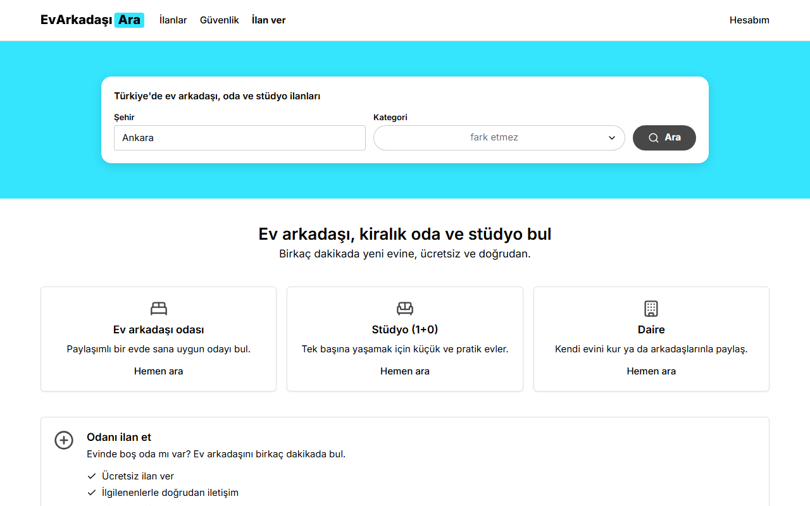
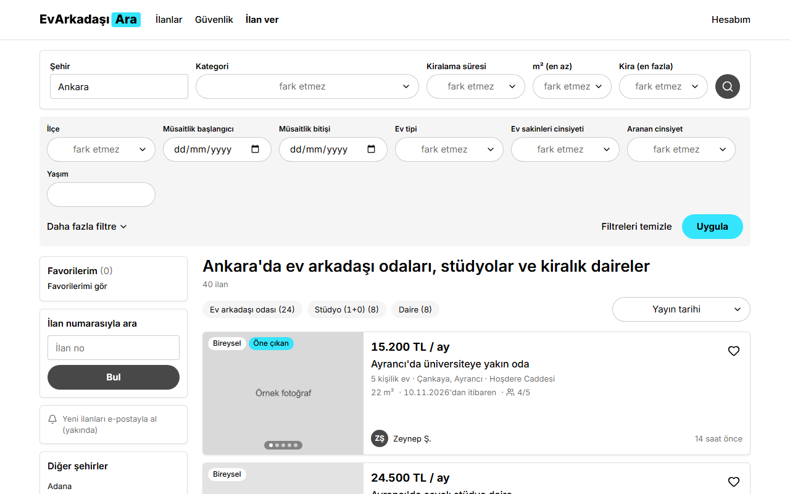
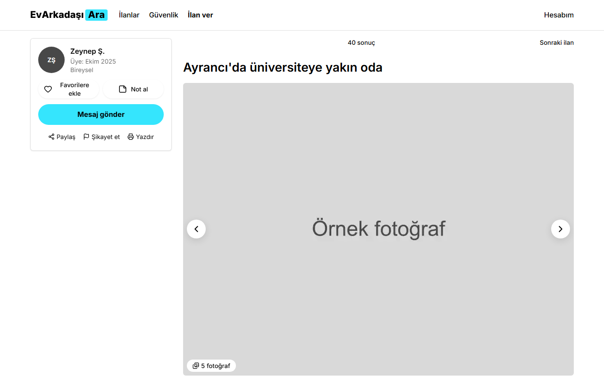
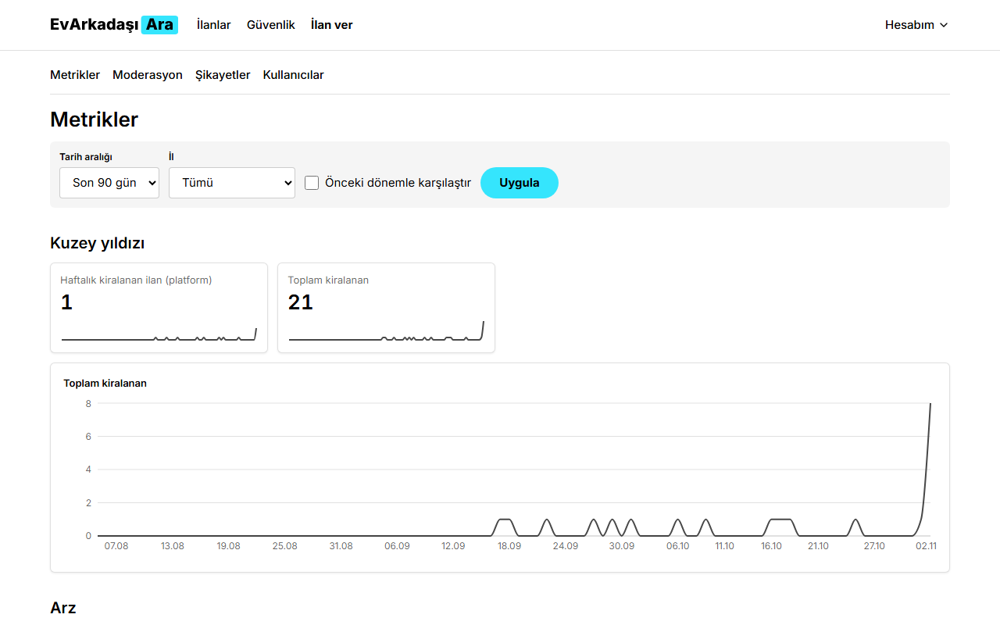
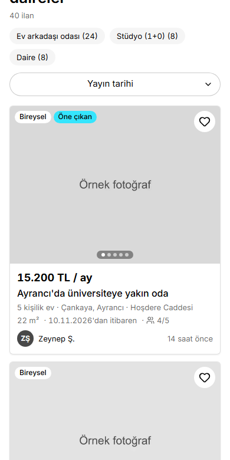

<div align="center">

# EvArkadaşı<mark>Ara</mark>

**Türkiye'de ev arkadaşı, kiralık oda ve stüdyo ilanları. Ücretsiz ve doğrudan.**

A free, list-first shared-housing site for Turkey, covering all 81 provinces.<br>
Dense, plain and fast, in the spirit of classic WG-Gesucht.




</div>

## Contents

- [What it does](#what-it-does)
- [Screenshots](#screenshots)
- [Tech stack](#tech-stack)
- [Run it locally](#run-it-locally)
- [Database](#database)
- [Quality checks](#quality-checks)
- [Security and privacy](#security-and-privacy)
- [Project layout](#project-layout)
- [Before launch](#before-launch)

## What it does

**For people searching**

- Search by province, district and category, with a filter strip whose state lives in the URL, so every search can be shared
- Browse and read listings without an account
- Message listers through the site, with a safety briefing the first time and a warning on words like "kapora"
- Save favorites and private notes

**For people listing**

- A single long form with autosave, a draggable map pin and photo upload
- Exact addresses stay private: the public map shows a 300 m circle around a shifted point
- Free stats on every listing: messages, visitors and a quality score
- One-click "Yayında tut" renewal from email

**For the operator**

- A moderation queue with automatic flags for low rent, scam words, contact details and reused photos
- A metrics dashboard with seven sections and a north star: *listings rented through the platform*
- Tools for reports, bans, business accounts and test boosts

> Searchers never pay, and posting is free. Paid boosts and business accounts exist only as inactive hooks.

## Screenshots

| Results | Listing |
| :---: | :---: |
|  |  |

| Admin dashboard | Mobile |
| :---: | :---: |
|  |  |

Listings, people and photos shown here are fake seed data.

## Tech stack

| Area | Choice |
| :--- | :--- |
| Framework | Next.js App Router, TypeScript strict, Server Components and Server Actions |
| Styling | Tailwind CSS tokens, Radix primitives, Lucide icons |
| Backend | Supabase: Postgres, Auth, Storage, Realtime and Row Level Security |
| Forms | react-hook-form, with zod checked again on the server |
| Maps | Leaflet with OpenStreetMap tiles |
| Text | next-intl: all UI copy lives in `messages/tr.json` |
| Charts | Recharts, admin only |
| Email | Resend |
| Tests | Playwright, axe and Lighthouse |

## Run it locally

Requires Node 20.9 or newer.

```sh
npm install
npx playwright install chromium
cp .env.example .env.local   # then fill in the values
npm run dev
```

Open <http://localhost:3000>.

| Page | Address |
| :--- | :--- |
| Homepage | <http://localhost:3000> |
| Listings in Ankara | <http://localhost:3000/ankara> |
| Post a listing (needs login) | <http://localhost:3000/ilan-ver> |
| Admin dashboard (needs admin) | <http://localhost:3000/admin/metrics> |
| Design system | <http://localhost:3000/dev/ui> |

### Logging in during development

Supabase does not allow custom email templates on its built-in mailer, and it only sends a few emails per hour. So until Resend is connected, the login email contains a **link** instead of a 6-digit code. Click it in the same browser. The code screen works once [Resend is connected](#before-launch).

### Making yourself an admin

Log in once, then run this in the Supabase SQL editor with your own email:

```sql
update public.profiles
set role = 'admin'
where id = (select id from auth.users where email = 'you@example.com');
```

## Database

Migrations live in `supabase/migrations`.

```sh
npx supabase login
npx supabase link --project-ref <project-ref>
npx supabase db push
```

- **Reference data:** 81 provinces and 973 districts ship in a migration. Names come from [turkiye-api](https://github.com/ubeydeozdmr/turkiye-api) (MIT) and district coordinates from Wikidata (CC0). `scripts/generate-geo-seed.mjs` rebuilds it.
- **Fake data:** `npm run seed` creates 5 users, 40 Ankara listings and 60 days of events. It refuses to run unless `SEED_TARGET_REF` names the project in `.env.local`, so it cannot reach production by accident.
- **Nightly jobs:** `pg_cron` expires old listings and computes metrics at 00:30 Istanbul time. `vercel.json` schedules the expiry warning emails.

## Quality checks

```sh
npm run lint
npm run typecheck
npm run test:smoke
```

`test:smoke` builds the app and serves it on port 3100. It runs two browsers at a time, because the free database tier slows sharply beyond that.

Latest results:

| Check | Result |
| :--- | :--- |
| Lint and type-check | Pass |
| Playwright smoke tests | 96 tests |
| Accessibility (Lighthouse) | 100 on homepage, results and detail |
| Mobile performance (Lighthouse) | Homepage 97, results 97, detail 86 |
| Results page LCP on mobile | 1.0 s |

To run Lighthouse, serve a production build, then:

```sh
npm run lighthouse -- http://localhost:3100/ankara
```

## Security and privacy

- **Least privilege:** Supabase's default grants are replaced with exact ones, and new tables start closed.
- **No private data in public reads:** the public reads through views that leave out door numbers, exact coordinates and phone numbers.
- **Server-side writes:** listing changes go through server actions that validate input and run moderation, so owners cannot approve themselves.
- **Photo privacy:** the browser strips EXIF by redrawing the image, and the server checks again before storing it.
- **Contact masking:** phone numbers and links in descriptions are masked for logged-out visitors in the database view, not just the UI.
- **Account deletion:** removes the profile, listings and photos. Conversations stay for the other person, with the sender erased.
- **Events:** never hold message text, emails, phone numbers or IP addresses.

## Project layout

```text
messages/tr.json        All Turkish UI text
src/app/                Pages and API routes
src/components/         UI, grouped by area
src/lib/                Data access, server actions, business rules
supabase/migrations/    Database schema and reference data
scripts/                Seed, geo data and Lighthouse
tests/smoke/            Playwright tests, one file per phase
docs/decisions.md       Decisions on top of the brief
```

## Before launch

**Accounts to connect**

| Service | What it unlocks | Variables |
| :--- | :--- | :--- |
| Domain + Resend | 6-digit login emails, message and review notifications | `RESEND_API_KEY`, `EMAIL_FROM` |
| Vercel | Hosting and the daily expiry warning | `CRON_SECRET`, `RENEW_TOKEN_SECRET` |
| Google OAuth | "Google ile devam et" | `NEXT_PUBLIC_GOOGLE_AUTH_ENABLED` |
| Cloudflare Turnstile | Bot protection | `NEXT_PUBLIC_TURNSTILE_SITE_KEY`, `TURNSTILE_SECRET_KEY` |
| Umami or Plausible | Web analytics | `NEXT_PUBLIC_ANALYTICS_*` |
| Supabase production project | A clean database with backups | The Supabase variables |

After connecting Resend as custom SMTP in Supabase, uncomment the template blocks in `supabase/config.toml` and run `npx supabase config push`.

**Settings to change for production**

- Set `sign_in_sign_ups` and `token_verifications` in `supabase/config.toml` back to 30. They are raised so the test suite can log in repeatedly on the dev project.
- Add the live domain to `site_url` and `additional_redirect_urls` in the same file.

**Content and legal**

- Replace the draft legal pages, which are marked "TASLAK: Hukuki inceleme gerekli"
- Get a lawyer's view on the open questions in [`docs/decisions.md`](docs/decisions.md), especially EİDS and transfers abroad under KVKK

---

Product spec: [`EvArkadasiAra_BRIEF.md`](EvArkadasiAra_BRIEF.md). Decisions on top of it: [`docs/decisions.md`](docs/decisions.md).
